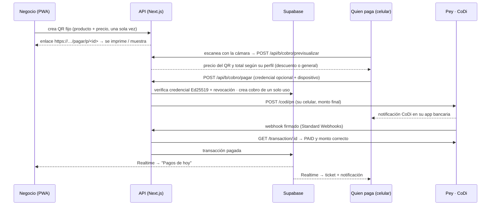

# Descuento Verificado · Cobro con descuento verificado sobre CoDi

> Hackatón México · Pey + AI Builders México + SpaceXAI

**Problema:** estudiantes, personas adultas mayores (INAPAM) y otros grupos tienen descuentos por convenio, pero en cada compra deben mostrar una credencial física: fricción, fraude y cero registro.

**Solución:** se verifica la elegibilidad **una vez por periodo** (correo institucional o documento revisado con IA) y se emite una **credencial digital firmada (Ed25519)** que vive en la app del cliente. El negocio tiene **QR fijos con precio** (uno por producto o servicio, impresos o en pantalla). Quien paga lo **escanea con la cámara de su celular**, ve el precio y paga **según su perfil**: con su descuento de estudiante o INAPAM, o a precio general si no tiene credencial. El servidor valida la firma del emisor, la vigencia, la revocación y el dispositivo, calcula el descuento y envía la **solicitud de cobro CoDi a su celular** (API de Pey). El negocio ve cada pago en tiempo real y nunca ve nombre, edad ni celular: solo "descuento: convenio X" o "precio general".

## Arquitectura



| Paquete | Qué contiene | Reutilizable en Expo |
|---|---|---|
| `packages/core` | Motor de reglas, credenciales (jose/EdDSA), QR de cobro, elegibilidad, estados de pago | Sí (sin React DOM ni Next) |
| `packages/pey` | Cliente tipado de Pey, verificación de webhooks, simulador opt-in | Sí (servidor) |
| `packages/db` | Tipos generados de Supabase + `RepositorioSupabase` | Sí (servidor) |
| `packages/ui` | Tokens de diseño (colores, tipografía ≥ 18 px, toque ≥ 48 px) | Sí |
| `apps/web` | PWA + API | — |
| `supabase/` | Migraciones, RLS, seed | — |

Detalle de la integración: [`docs/PEY.md`](docs/PEY.md).

## Cómo arrancarlo

### Requisitos
- Node ≥ 20.18 y pnpm (`corepack enable`)
- Un proyecto de Supabase con las migraciones de `supabase/migrations` y `supabase/seed.sql` aplicadas
  (el proyecto del equipo ya las tiene: ref `dytxbichhnnopmqoyzgf`)

### 1. Instalar
```bash
pnpm install
```

### 2. Variables de entorno
```bash
cp .env.example apps/web/.env.local
pnpm keys:generate -- uttab inapam   # pega las 4 líneas ISSUER_* en .env.local
openssl rand -base64 48              # pégalo en VERIFICACION_SECRET
```

| Variable | De dónde sale | Obligatoria |
|---|---|---|
| `NEXT_PUBLIC_SUPABASE_URL`, `NEXT_PUBLIC_SUPABASE_ANON_KEY` | Supabase → Project Settings → API | Sí |
| `SUPABASE_SERVICE_ROLE_KEY` | Supabase → Project Settings → API (**secreta**, solo servidor) | Sí |
| `VERIFICACION_SECRET` | `openssl rand -base64 48` | Sí |
| `ISSUER_<ID>_PRIVATE_KEY` / `_PUBLIC_KEY` | `pnpm keys:generate -- <id>` | Sí, una por emisor |
| `PEY_API_KEY`, `PEY_WEBHOOK_SECRET` | portal.mipey.mx → Desarrollador | Sí, salvo `PEY_SIMULADO=true` |
| `PEY_SIMULADO` | `true` solo para desarrollar sin API key (no mueve dinero) | No |
| `MODO_PRUEBA`, `MONTO_PRUEBA_MXN` | Por defecto `true` y `0.10`: se cobran $0.10 reales en lugar del total | No |
| `XAI_API_KEY`, `XAI_MODEL` | console.x.ai (`grok-4.7`). Sin llave, los documentos van a revisión manual | No |
| `DEMO_MODE` | `true` muestra el selector de rol con usuarios demo | No |

### 3. Configurar Supabase Auth (una vez)
Authentication → URL Configuration → **Redirect URLs**: agrega `http://localhost:3000/auth/callback` (y la URL de Vercel en producción).

### 4. Correr
```bash
pnpm dev                       # http://localhost:3000
# o en modo producción (prueba la PWA y el service worker):
pnpm build && pnpm --filter @cdv/web start
```
La cámara del escáner requiere HTTPS fuera de `localhost`. Para probar en tu celular usa un túnel:
```bash
cloudflared tunnel --url http://localhost:3000
```

### 5. Webhooks de Pey en local
1. Abre el túnel (paso anterior) y copia la URL `https://….trycloudflare.com`.
2. En portal.mipey.mx → Desarrollador → ⚙️ de tu API key → URL: `https://…/api/webhooks/pey`.
3. Copia el secreto `whsec_…` a `PEY_WEBHOOK_SECRET`.

## Cómo probar con MODO_PRUEBA

Guion completo de la demo: [`docs/DEMO.md`](docs/DEMO.md).

1. En la computadora entra como **Comercio · Negocio de Ramón Orraca** → **Mis QR** → abre "Café latte $48" (o crea uno nuevo con su precio).
2. En el celular (por la URL `https://`) escanea el QR con la **cámara normal** y toca el enlace.
3. Elige quién paga: **Luis** (estudiante, 20 % en café), **Carmen** (INAPAM, 15 %) o **Pedro** (público general, sin descuento).
4. Registra tu celular con CoDi cuando lo pida y toca **Pagar con CoDi**. Con `MODO_PRUEBA=true` se cobran **$0.10 reales**; el ticket muestra el desglose completo.
5. Autoriza en tu app bancaria. En el negocio, **Pagos de hoy** muestra el pago al instante.
6. **Efectivo:** "Pagaré en efectivo" → el negocio toca **"Recibí el efectivo"**.

Pey solo tiene producción y **no devuelve pagos**. Todos los cobros llegan a la cuenta CoDi ligada a la API key (Ramón Orraca).

## Pruebas
```bash
pnpm test          # unitarias: core (40) + pey (22)
pnpm typecheck && pnpm lint
```
Pruebas de base de datos (RLS, funciones atómicas, restricciones): ver `supabase/tests/rls.sql`.

## Seguridad y privacidad
- El QR fijo solo lleva el id del producto (sin datos personales). El precio vive en la base y solo el negocio lo define; quien paga no puede cambiarlo.
- Cada escaneo crea su propio cobro de un solo uso (`tomar_solicitud` atómico); el QR se reutiliza sin riesgo de pagos duplicados.
- La credencial del cliente se verifica en cada pago: firma Ed25519 del emisor, revocación, vigencia y dispositivo ligado.
- El monto y el descuento siempre se calculan en el servidor. El comercio nunca ve nombre, edad ni celular.
- Webhook verificado sobre el cuerpo crudo y **confirmado consultando la transacción** en Pey (monto, canal, referencia).
- RLS en todas las tablas; escrituras solo vía API. Reportes del emisor solo agregados.
- Documentos en Storage privado, borrados al terminar la verificación.

## Ruta a la app Expo
`apps/mobile` queda reservado. `packages/core`, `packages/ui` (tokens) y los tipos de `packages/db` se reutilizan tal cual; se reescriben las pantallas con React Native y el escáner con `expo-camera`. Ver `docs/MOBILE.md` (pendiente).
